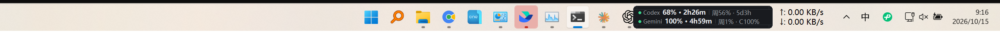

# CodexQuotaBar

把 Codex 的 5 小时 / 周额度显示在 **Windows 任务栏**上的小挂件。



> 纯标准库实现，不装任何第三方包。**不依赖 TrafficMonitor**，也不依赖任何第三方插件。


- 颜色预警：剩余 **>30% 绿 ／ >10% 黄 ／ ≤10% 红**，离线灰
- 悬停显示明细：已用百分比、重置倒计时、周用量、上次查询时间
- 自动避让：会扫描任务栏上已有的挂件（TrafficMonitor 等），自动排到它们左边，不会遮挡
- 拖动可移动，松手靠近任务栏自动吸附；双击立即刷新；右键出菜单
- 开机自启、单实例保护、日志自动轮转

---

## 它是怎么工作的

挂件本身**不联网**，中间有一个本地取数服务：

```
┌────────────────┐   HTTP    ┌──────────────────┐   POST    ┌──────────────┐
│  任务栏挂件     │ ────────▶ │  本地取数服务     │ ────────▶ │  上游代理      │
│ codex_quota_bar │ 127.0.0.1│  quota_bridge.py  │           │ (你的 API 代理) │
└────────────────┘           └──────────────────┘           └──────────────┘
  只负责显示                     解析 / 算剩余 / 倒计时          转发到 ChatGPT
```

**为什么分两层：** 上游接口返回的 `body` 是一段转义过的 JSON 字符串，
第三方 TrafficMonitor 插件的 JSONPath 没法穿透它，而且插件也不支持
`100 - used_percent` 这类运算。拆成两层后，挂件这一层保持零依赖，
换上游代理也不用改代码 —— 只改 `config.json`。

取数服务还做了两件事：**90 秒缓存**（别把上游打太狠）和
**按缓存时间戳扣减倒计时**（所以倒计时走的是真实时间，不会因为刷新间隔而卡顿）。

---

## 环境要求

- Windows 10 / 11
- Python 3.10 以上（用标准安装包即可，自带 tkinter）
- 一个能访问 ChatGPT 的上游代理，需要提供三样东西：

  | 配置项 | 含义 |
  |---|---|
  | `proxy` | 代理地址，例如 `http://192.168.1.10:8317` |
  | `management_key` | 代理的管理密钥（请求头 `X-Management-Key`） |
  | `auth_index` | 该代理里 Codex 账号的 `auth_index` |

  > **怎么拿 `auth_index`：** 用管理密钥调代理的
  > `GET /v0/management/auth-files`，返回里 `type` 为 `codex` 的那条，
  > 它的 `auth_index` 字段就是要填的值。

---

## 安装

1. 把整个文件夹复制到任意位置（建议 `D:\Software\CodexQuotaBridge` 这类简单路径）
2. 把 `config.example.json` 复制成 `config.json`，填好上面那三项
3. 双击 **`install.bat`**

`install.bat` 会自动探测常见的 Python 安装路径，先自检配置和连通性，
通过了才写入开机自启并启动；任何一步失败都会停下来告诉你原因。

---

## 配置项

| 键 | 默认值 | 说明 |
|---|---|---|
| `proxy` | — | 上游代理地址（**必填**） |
| `management_key` | — | 代理管理密钥（**必填**） |
| `auth_index` | — | Codex 账号的 auth_index（**必填**） |
| `bridge_port` | `28317` | 本地取数服务端口，被占用就改 |
| `refresh_seconds` | `30` | 挂件刷新频率（秒） |
| `cache_seconds` | `90` | 实际查询上游的间隔（秒） |
| `log_file` | `quota_bridge.log` | 日志文件名 |

`refresh_seconds` 和 `cache_seconds` 分开设，是为了让倒计时走得平滑
又不至于频繁打上游。

---

## 日常操作

| 操作 | 方式 |
|---|---|
| 看明细 | 鼠标悬停 |
| 立即刷新 | 双击挂件 |
| 移动位置 | 按住拖动，松手靠近任务栏会自动吸附 |
| 改刷新间隔 / 开机自启 / 退出 | 右键菜单 |

## 命令行

```bat
python codex_quota_bar.py --check      自检配置并试拉一次数据
python codex_quota_bar.py --install    写开机自启并启动
python codex_quota_bar.py --uninstall  取消自启并停止
python codex_quota_bar.py              直接启动（不加自启）
```

## 卸载

双击 `uninstall.bat`。它会取消开机自启并停掉进程，文件保留。
想彻底删掉就直接删整个文件夹。

---

## 文件说明

| 文件 | 作用 |
|---|---|
| `codex_quota_bar.py` | 挂件本体，只负责显示，不联网 |
| `quota_bridge.py` | 本地取数服务 |
| `config.example.json` | 配置模板（复制成 `config.json` 使用） |
| `install.bat` / `uninstall.bat` | 一键安装 / 卸载 |
| `quota_bridge.log` | 取数服务日志，超过 256KB 自动轮转 |
| `widget.log` | 挂件日志：异常、看门狗自愈记录 |
| `bar.pid` / `bridge.pid` | 运行时 PID，供卸载脚本精确定位 |

---

## 常见问题

**任务栏上没有出现**

先跑 `python codex_quota_bar.py --check`。取数正常但看不到挂件的话，
多半是有别的工具占了位置 —— 右键菜单选「重新贴回任务栏」。

通常等 15 秒会自己恢复：挂件内置了看门狗，每 15 秒检查一次画布，
发现画布空了（比如锁屏/休眠唤醒后 Tk 丢绘制）就自动重建，
并重新抢一次置顶。恢复过程会记到 `widget.log`：

```
[2026-10-15 08:15:37] [TEST] artificially blank the canvas, verify watchdog self-heal
[2026-10-15 08:15:47] 检测到画布为空，自动重建
```

> 挂件用 `pythonw.exe` 运行，没有 stderr，所以异常全部落在 `widget.log`。
> 挂件看起来空白但进程还在时，先看这个文件。

**显示「-- 离线」**

`quota_bridge.log` 里有具体错误。多数是上游代理不可达或密钥过期。

**端口被占用**

改 `config.json` 里的 `bridge_port`。

**能不能同时看多个账号**

一个挂件对应一个 `auth_index`。要同时看多个就复制一份文件夹，
改端口和 `auth_index` 再装一次，两个挂件会自动左右排开。

**会不会和 TrafficMonitor 打架**

不会。定位时会枚举任务栏的子窗口，找出第三方挂件（含 TrafficMonitor
挂在 `Shell_TrayWnd` 下的那个），把自己放到它们左边。

---

## ⚠️ 安全提醒

`config.json` 里的 `management_key` 是**等价于账号密码的凭据**。

- 它已经在 `.gitignore` 里，不要手动 `git add -f`
- 不要把它提交到任何公开仓库
- 不要贴进 issue、日志截图、网盘公开链接

## License

MIT